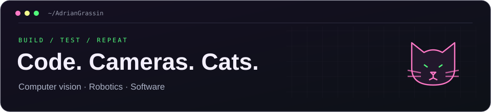

  

## Hey, I'm Adrián 👋

Student at the **University of La Laguna**, based in **Tenerife**. I work on computer vision, drones, and the software that connects them.

This profile is a mix of university projects, experiments, and things I wanted to see working.

### What I'm building

- **Vision for drones** — detecting people and running models on edge hardware.
- **Synthetic datasets** — simulation, image generation, and testing what transfers to real images.
- **Connected systems** — video streams, telemetry, and tools to make the pieces work together.

### Things I work with

`Python` `C++` `C#` `PyTorch` `OpenCV` `Unreal Engine` `Jetson` `Linux`

### GitHub activity

  
  

Public repositories · cards refreshed daily with GitHub Actions.

---

  <em>Built with curiosity, Codex, and questionable amounts of patience. The cats handle supervision.</em>

