# Adrián Grassin

Student at the **University of La Laguna**, Tenerife.

My projects cover a few different areas:

- **AI:** language models, diffusion, distillation and computer vision.
- **Computational mathematics:** algorithms, combinatorics and complexity.
- **Simulation:** neural systems, maritime navigation and 3D environments.
- **Applications:** desktop and web tools, automation, drones and video streaming.

`Python` `C++` `C#` `TypeScript` `PyTorch` `CUDA` `React` `Unreal Engine` `Linux`

  
  &nbsp;
  

### GitHub

  
  

Public repositories · updated daily.
